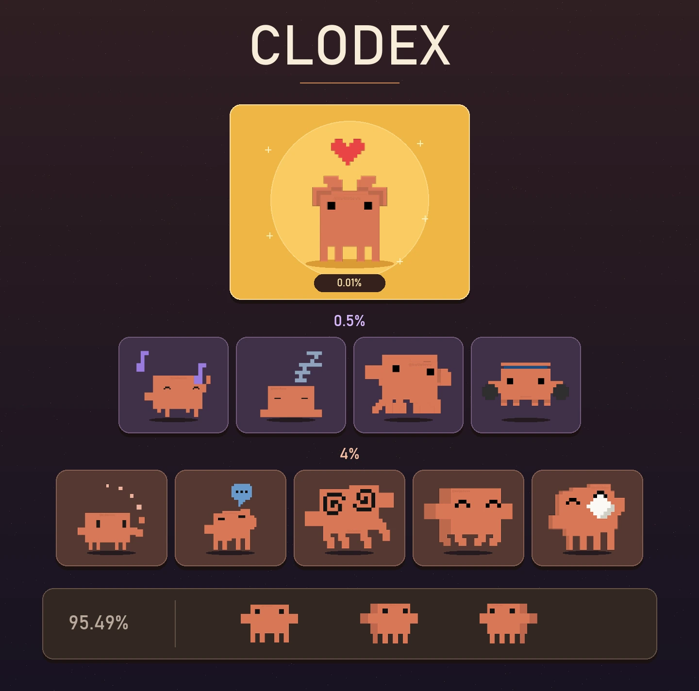

# Clodex

[Русская версия](README.ru.md)

**The merger of two symbiotes – Codex and Claude**

**Install with your agent** · “Install Clodex from this repository and switch to the modified Codex after I confirm.”

A request to install Clodex from this repository starts the Windows mod setup. The agent checks compatibility, prepares the separate copy, and asks before closing your current Codex. A stock pet with standard animations is available on explicit request. [Agent installation instructions](AGENTS.md)



Clodex is a pixel companion for the **Pets menu in Codex**. The Windows mod adds weighted idle animations, repeats, and alternate reactions.

## Rarities

| Idle tier | Chance per roll |
| --- | ---: |
| Common | 95.49% |
| Rare | 4% |
| Very rare | 0.5% |
| Legendary | 0.01% |

Clodex rolls after the base idle animation and an eight-second pause. Six special clips play 3–5 times in a row. A successful turn picks one of two reactions with equal probability.

## Install with Codex

Send this repository link to your agent and ask it to install Clodex. The mod uses a separate profile, so you may need to sign in again. Once the modified copy opens, choose **Clodex** in **Settings → Pets**. The stock client remains available from the Windows Start menu.

### Manual setup

This build targets Windows and Codex package `26.1117.4957.0`. Run the build from the repository root with Python installed:

```powershell
$codex = Get-AppxPackage -Name OpenAI.Codex
python .\build_desktop_copy.py (Join-Path $codex.InstallLocation 'app')
```

When Clodex is already in your cloud Pets collection, add `--pet-id` with the exact ID from Pets. To add a local copy, run `python .\scripts\pet_packs.py install kav-clodex` and refresh the Pets list.

Run `.\scripts\switch-codex.ps1` to preview the switch. Save your work, then run `.\scripts\switch-codex.ps1 -Apply`. If Codex stays in the tray, choose **Quit** and retry. The switch log is written to `switch.log`.
