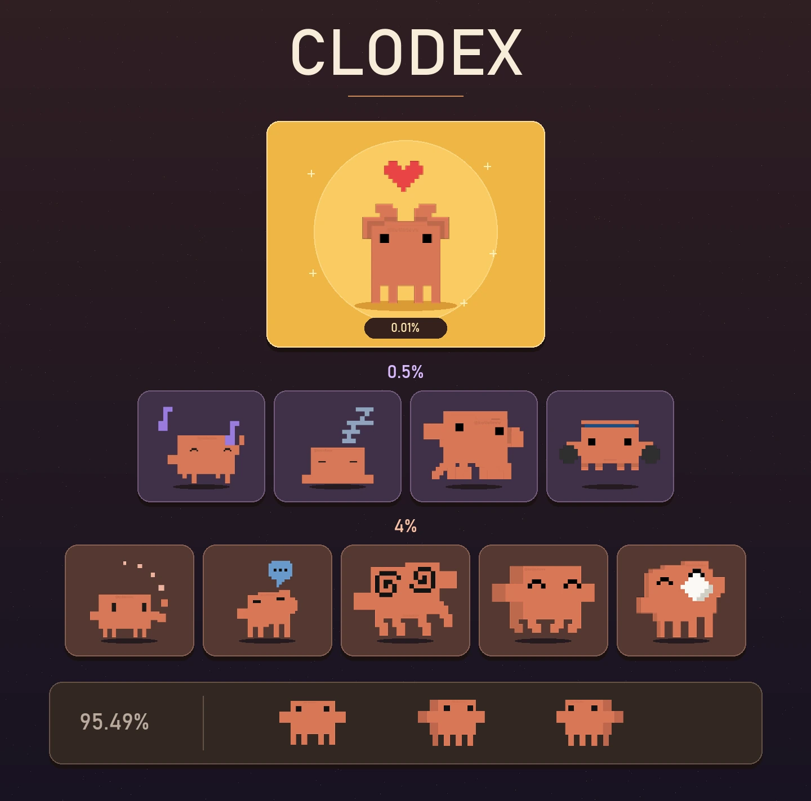

# Clodex

[English version](README.md)

**The merger of two symbiotes – Codex and Claude**



Clodex — пиксельный помощник в **меню Pets в Codex**. Мод для Windows добавляет редкие анимации простоя, повторы и варианты реакций.

## Редкости

| Редкость | Шанс при каждом выборе |
| --- | ---: |
| Обычная | 95,49% |
| Редкая | 4% |
| Очень редкая | 0,5% |
| Легендарная | 0,01% |

Clodex выбирает следующий клип после базовой анимации и паузы в восемь секунд. Шесть особых клипов проигрываются по 3–5 раз подряд. При успешном завершении задачи одна из двух реакций выпадает с равной вероятностью.

## Установка через Codex

Отправь агенту ссылку на репозиторий и попроси установить Clodex. Агент объяснит, что потребуется модифицированная сборка, и запросит согласие перед закрытием текущего окна Codex. Сборка запускается с отдельным профилем, поэтому может понадобиться войти заново. После запуска выбери **Clodex** в **Settings → Pets**. Штатный клиент по-прежнему доступен из меню «Пуск».

### Ручная установка

Сборка рассчитана на Windows и пакет Codex версии `26.1117.4957.0`. С установленным Python выполни из корня репозитория:

```powershell
$codex = Get-AppxPackage -Name OpenAI.Codex
python .\build_desktop_copy.py (Join-Path $codex.InstallLocation 'app')
```

Если Clodex уже в облачной коллекции Pets, передай его точный ID через `--pet-id`. Для локальной установки питомца выполни `python .\scripts\pet_packs.py install kav-clodex` и обнови список Pets.

Команда `.\scripts\switch-codex.ps1` покажет, какой клиент будет запущен. Сохрани работу и выполни `.\scripts\switch-codex.ps1 -Apply`. Если штатный Codex остался в трее, выйди из него через **Quit** и повтори команду. Журнал переключения записывается в `switch.log`.
